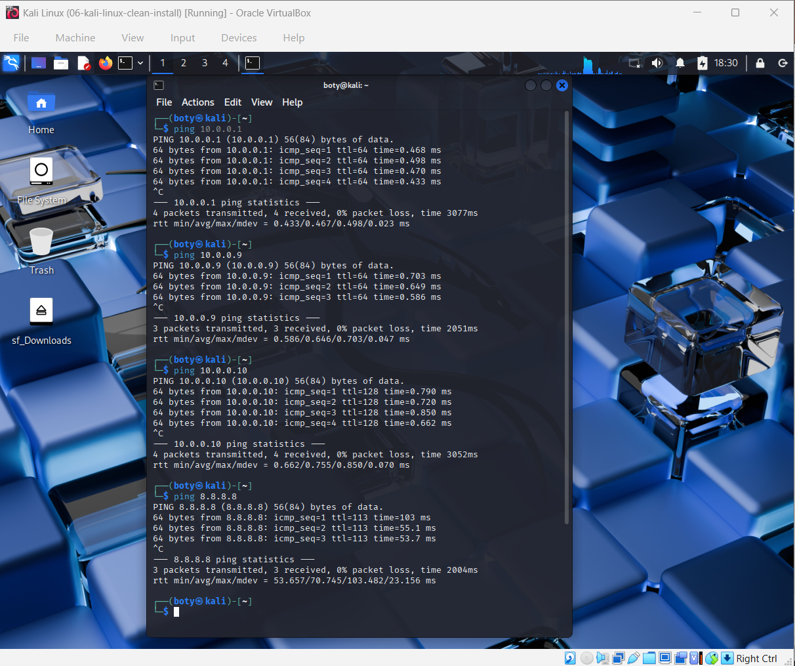
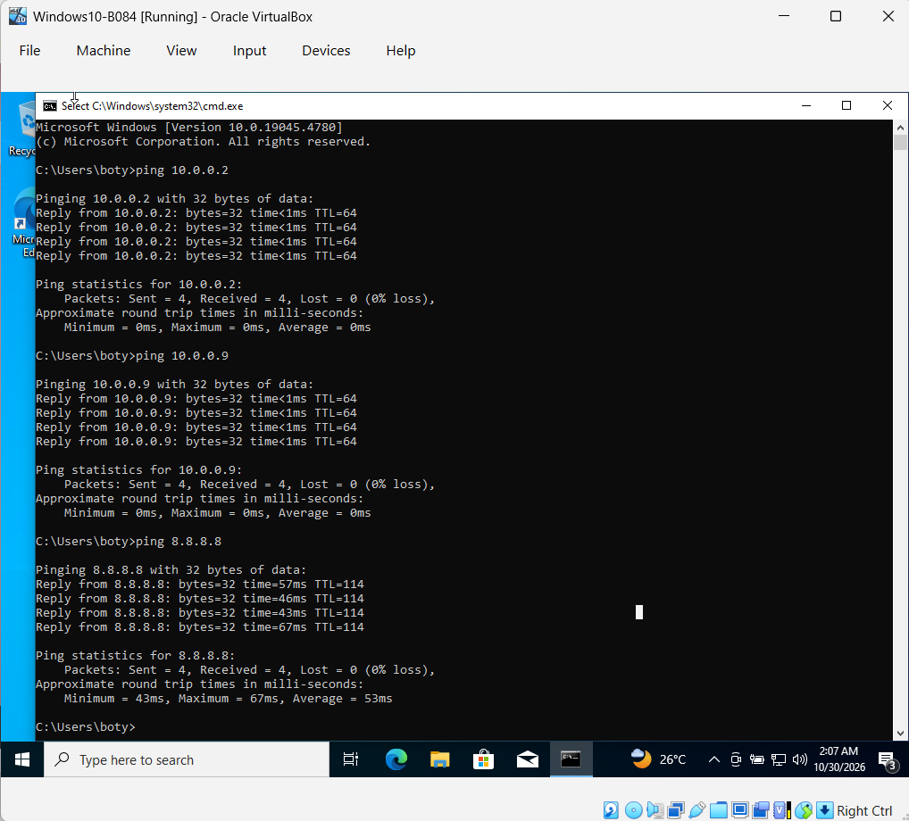
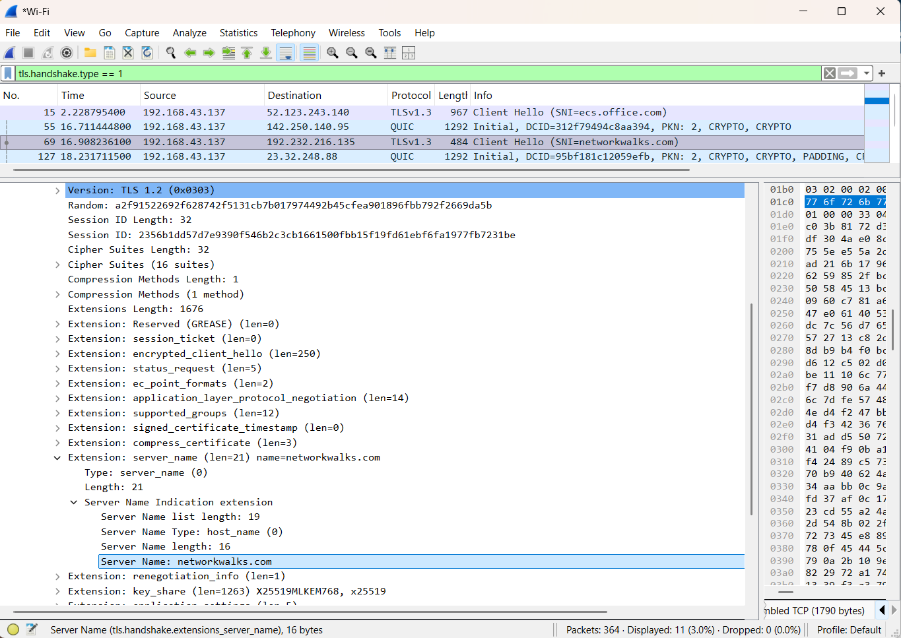

# Cybersecurity Week 1 - NAT Network & Wireshark Labs
By Sumboty | Networkwalks Academy

## 🎯 Project Overview
Week 1 extra project - Built a fully functional NAT Network lab with 3 VMs and verified bidirectional connectivity + Wireshark analysis.

### Network Topology: NAT Network `NatNetwork` - 10.0.0.0/24
| Device | IP Address | Role |
|--------|------------|------|
| Gateway | 10.0.0.1 | NAT Gateway |
| Kali Linux | 10.0.0.2 | Attacker / Analysis Machine |
| Android | 10.0.0.9 | Client Device |
| Windows Host | 10.0.0.10 | Management |

## 📁 Folder Structure

### 01-NAT-Network-Lab - VirtualBox NAT Lab + Ping Proofs
This folder contains all proof of NAT Network working with 0% packet loss.

**Files:**
- `Kali-10.0.0.2-fixed-ip-a.png` - Kali IP fixed to 10.0.0.2/24 (was 10.0.0.4 reservation bug)
- `VirtualBox-Kali-NATNetwork-NatNetwork-VMS...` - VirtualBox config: 128MB Video, VMSVGA, 3D OFF, NAT Network
- `Kali-Final-Ping-4-way-0-loss-Gateway-Android...` - **MAIN PROOF**: Kali pings 10.0.0.1, 10.0.0.9, 10.0.0.10, 8.8.8.8 = 0% loss
- `Windows-Final-Ping-3-way-0-loss-Kali-Android...` - Windows pings Kali, Android, Internet = 0% loss
- `Android-Ping-0-loss-10.0.0.2-10.0.0.10-8.8.8.8...` - Android pings Kali, Windows, Internet = 0% loss

**Result:** Triangle verified - Full bidirectional 0% loss + Internet access!

### 02-Wireshark-Lab - Traffic Analysis
Domain analyzed: `networkwalks.com` -> `192.232.216.135`

**Files:**
- `Wireshark-Lab1-DNS-192.232.216.135.png` - DNS query and response
- `Wireshark-Lab1-SNI-networkwalks.com.png` - TLS SNI filtering for networkwalks.com

**Findings:**
- SNI clearly shows networkwalks.com in Client Hello
- DNS A record 192.232.216.135 verified
- TLSv1.3 handshake

### 03-Quiz - Wireshark Quiz
- `Wireshark-Quiz-80-Percent-30Oct2026.png` - Quiz result 80% - 30 Oct 2026

## 🔧 Troubleshooting Done (Real SOC Skills)
1.  **Fixed Kali IP 10.0.0.4 bug:** Fresh Kali install, configured /etc/network/interfaces for 10.0.0.2/24, gateway 10.0.0.1
2.  **Fixed Android Black Screen:** Set VirtualBox -> Display -> Video Memory 128MB, Graphics Controller VMSVGA, Uncheck 3D Acceleration
3.  **Verified NAT Network:** Created NatNetwork 10.0.0.0/24 with DHCP enabled

## ✅ Final Verification
- [x] Kali 10.0.0.2 <-> Gateway 10.0.0.1 = 0% loss
- [x] Kali 10.0.0.2 <-> Android 10.0.0.9 = 0% loss
- [x] Kali 10.0.0.2 <-> Windows 10.0.0.10 = 0% loss
- [x] All VMs -> Internet 8.8.8.8 = 0% loss
- [x] Wireshark DNS + SNI verified
- [x] Quiz 80%

## 🔗 Repo Link
https://github.com/Sumboty/Cybersecurity-Week1-NAT-Wireshark-Labs

Ready for Week 2!
